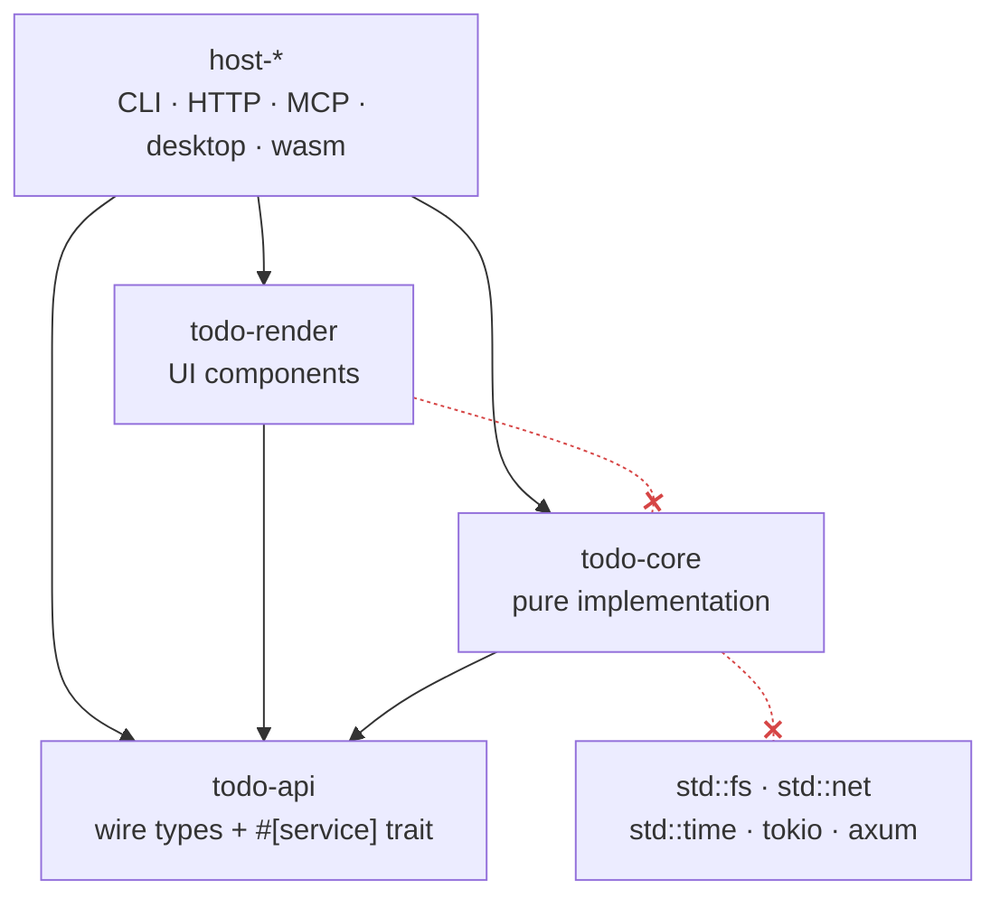

<div align="center">

# gabion

**One business core, every surface — and a wall that blocks the shortcuts.**

Write one core; it runs natively, in the browser as WebAssembly, and on a server.
Every surface — HTTP, CLI, MCP, OpenAPI, typed client — is generated from a single
`#[service]` declaration, and the shortcuts that rot an agent-written codebase are
unrepresentable rather than discouraged.

[](https://github.com/d-buckner/gabion/actions/workflows/ci.yml)
[](LICENSE)
[](rust-toolchain.toml)
[](docs/STATUS.md)

[The problem](#the-problem) · [Demo](#demo) · [Quick start](#quick-start) ·
[The walls](#the-walls) · [One declaration, every surface](#one-declaration-every-surface) ·
[Examples](#examples) · [Docs](#docs)

</div>

## What it is

gabion is a cross-platform Rust app framework for codebases that a lot of people
— and agents — will write into. You write one business core, and the framework
generates and enforces everything around it.

The name is the design. A [gabion wall](https://en.wikipedia.org/wiki/Gabion) is a
cage of rocks that holds back a slope while water drains through. The geometry does
the work, so nobody has to remember to maintain it. Here the geometry is the crate
graph, the compile targets and the static gates: the architecture is held by the
shape of the code, not by a reviewer's memory. That is why the rest of this page
keeps saying "wall".

## The problem

Slop is code that satisfies the request in front of it and breaks a rule nobody
restated in the prompt. An agent does not damage your architecture out of malice.
It takes the shortest path that compiles. So the shortest path has to be the
correct path.

A style guide cannot enforce that, and a reviewer cannot enforce it at the rate an
agent produces code. Only a mechanical block works — and it has to be stricter
than a linter, because the failure gabion targets is not a typo. It is a plausible
shortcut that passes every standard check.

## Demo

Every feature is three crates, so the wrong import does not exist:



One command checks all of it:

```console
$ cargo run -p gabion-cli -- check
gabion check: PASS (15 steps: config, graph, edges, clippy.toml, workspace lints,
  surfaces, sources, fmt, clippy, test, shear, deny, wasm, wasm, wasm)
```

Add `todo-core` to `todo-render`'s dependencies — or delete a ban from
`clippy.toml`, or add a method nobody reviewed — and the same command says:

```console
$ cargo run -p gabion-cli -- check --fast
FAIL process-wall
  at:     todo-render -> todo-core
  what:   todo-render (render) may not depend on todo-core (core)
  fix:    the render crate may name the service *trait* (from *-api) only; the
          host injects the impl. Never depend on *-core.

gabion check: 1 rule violation(s), 0 failing step(s), 0 skipped
```

Every finding carries a rule id, the location, and the fix rather than a
suppression. An agent with zero context can satisfy the gate without reading the
docs.

## Quick start

Rust comes from [rustup](https://rustup.rs). `rust-toolchain.toml` pins stable and
adds the wasm target, clippy and rustfmt automatically. The full gate also wants
`cargo install cargo-shear cargo-deny` (`--no-external` skips them).

The gate and the scaffolder ship as one crate, and neither needs a checkout —
`gabion new` writes an app that depends on the published crates:

```console
$ cargo install gabion-cli
$ gabion new myapp --dir /tmp/myapp
created 15 file(s) in /tmp/myapp
the scaffold copied the walls: clippy.toml, [workspace.lints], the edge table, and a surface lock with 2 reviewed operation(s)
next: cd /tmp/myapp && cargo build -p myapp-host-server
then: gabion check
when you add UI, its design system goes in a *-shared crate — the framework ships no styles
gabion check: PASS (0 steps: )

$ cd /tmp/myapp && cargo run -p myapp-host-server
serving: todo.create, todo.list
listening on http://127.0.0.1:3456

$ curl -s -X POST localhost:3456/api/todo.create -d '{"title":"buy sandspice"}'
{"id":"t1795187433-9dd7cada","title":"buy sandspice","done":false,"created_at":1795187433}

$ curl -s -X POST localhost:3456/api/todo.list -d '{}'
[{"id":"t1795187433-9dd7cada","title":"buy sandspice","done":false,"created_at":1795187433}]
```

The same core also builds for the browser, and the native host puts a CLI in front
of it:

```console
$ cargo build -p myapp-todo-core --target wasm32-unknown-unknown   # the target check
$ cargo run -p myapp-host-native
$ ./target/debug/myapp todo create --json '{"title":"buy sandspice"}'
$ ./target/debug/myapp ui          # the render crate, in-process
```

A Dioxus desktop window and a wasm board come with the examples:
`cargo run -p host-native -- gui`, or `./example/hosts/host-pulse-web/serve.sh`.

Adding a feature is one command. It writes the three crates, updates the
workspace members, and rewrites the surface lock so the new operations are a diff
you review:

```console
$ gabion feature add billing
added feature `billing`: billing-api | billing-core | billing-render
workspace members updated; .gabion/surfaces.lock now lists 4 operation(s) — review them like an API change
```

`gabion dev` watches, rebuilds and restarts. `check --fix`
applies the mechanical findings (a narrowed `pub`, the lock, a missing lints
opt-in) and leaves the rest for a decision.

## The walls

Three layers. Each catches what the layer above it cannot.

**1 · The crate graph.** A feature ships as `*-api` (wire types and the
`#[service]` trait), `*-core` (the pure implementation), and `*-render` (the UI).
`render` may not depend on `core` because the dependency is not in
`[dependencies]` — the compiler says E0432. Feature A may name feature B's
`*-api`, never its internals. There is no rule to forget and no lint to disable.

**2 · The effect ban.** `*-core` compiles for `wasm32-unknown-unknown`, but rust's
`std` ships wasm stubs for `fs`, `net`, `thread` and `time`, so a core that opens a
file or reads the clock still compiles and only fails at runtime. `clippy.toml`
enumerates those paths, `core-runtime-dep` rejects a runtime/server/client/store
in a core manifest, and the gate audits both. Effects move instead: `Clock`,
`Store`, `Sleep`, `Http` are capabilities the host injects, real natively and
virtual in tests.

**3 · `gabion check`.** Cargo's wall holds only while the dependency stays out of
`[dependencies]`; clippy's holds only while `clippy.toml` keeps its bans. So the
gate audits the configuration as well as the source.

```console
$ cargo run -p gabion-cli -- check     # one command, one exit code
```

| Step | What it enforces |
| --- | --- |
| `fmt`, `clippy`, `test` | rustfmt. clippy with the effect ban, `unwrap_used`/`expect_used` deny, and complexity caps. The full test suite, every feature on, so a gated test cannot be skipped into a vacuous green. |
| `shear`, `deny` | Unused dependencies. Licenses, advisories, sources. |
| `wasm` | Every `*-core` builds for `wasm32-unknown-unknown`, per feature. |
| `edges` | Every `Cargo.toml` against the edge table: process wall, feature wall, contract purity, upward leak, host dependency. |
| `clippy.toml`, `workspace lints` | The required bans and thresholds are still present, unsafe is still forbidden, and every member still opts into the lints. A deleted wall is a named failure. |
| `surfaces` | `.gabion/surfaces.lock` matches the reachable operation set, signature hashes included. |
| `sources` | No comments in `*-core` bodies, no silent defaults, no glob re-export from a contract, `#[allow]` only in a declared effect home, file and branch caps, no TODOs. |

The wall cannot be negotiated away in a one-line diff: `clippy-config` fails when a
threshold is raised or a ban deleted, and `effect-home-allow` fails when an
`#[allow]` appears outside a declared effect home. Every rule has a failing
fixture in `crates/gabion-cli/tests/`, and `dogfood.rs` runs the gate against this
repo — a wall that stops biting fails here first.

[**docs/RULES.md**](docs/RULES.md) has every rule id and the shortcut it seals, and
the edge table is data an app can tighten without patching the framework.

## One declaration, every surface

The trait is the boundary. Every method in a `#[service]` trait is generated into
every surface, with no per-method opt-in to forget. An op that must not be remote
is simply not in that trait:

```rust
// features/todo/todo-api/src/lib.rs
#[service]
pub trait TodoService {
    async fn create(&self, input: CreateTodo) -> Result<Todo, TodoErr>;
    async fn list(&self, _input: ()) -> Result<Vec<Todo>, TodoErr>;
}

// Not in the trait: another feature can call it in-process, no surface can reach it.
#[async_trait]
pub trait TodoInternals { async fn recompute_stats(&self) -> Result<(), TodoErr>; }
```

`#[service]` generates, behind cargo features, only what each host compiles:

| Feature | Generated artifact |
| --- | --- |
| (default) | `<Feature>Client<H: Http>` — the service trait implemented over `Http`, so a renderer cannot tell a remote impl from a local one |
| `registry` | `mount_on`: a host mounts an impl and gets the routes, the subcommand and the tools |
| `server` | an axum router, one `POST /api/<feature>.<method>` per method; errors map to status |
| `server` + `openapi` | an OpenAPI 3.1 document for exactly those routes |
| `mcp` | one JSON-RPC tool per method, with an inlined input schema |
| `cli` | a clap subcommand tree with async dispatch; errors map to exit codes |
| `conformance` | one case driven through all four adapters and compared |

Every method takes `ctx: &Ctx` (principal, tenant, trace, cancellation), filled in
by each surface — HTTP from headers, MCP from `_meta`, the CLI from flags — so
authorization is representable because the contract can see who is calling.

Because there is no annotation to review, the reviewable artifact is the *set*: a
new operation fails the build until `--update-surfaces` is run and committed.
[**docs/SURFACES.md**](docs/SURFACES.md) covers the wire shape, the MCP server, the
error mapping and the committed UI snapshots.

## Examples

| Example | Shape | What it proves |
| --- | --- | --- |
| [`example/features/todo`](example/features/todo) + `hosts/host-{server,native,web}` | one feature, three crates, every built surface | the minimal shape. Everything quoted above is from it. |
| [`example/features/pulse`](example/features/pulse) + `hosts/host-pulse-*` | two features that call each other, four hosts | the same walls under load |

The pulse monitor is a service monitor with a playable status board:

```
example/features/checks/      checks-api | checks-core        watch URLs, probe them
example/features/incidents/   incidents-api | incidents-core  open and close outages
example/features/pulse/       pulse-render                   the status board
example/hosts/host-pulse-{cli,server,native,web}             four hosts, one core
```

- **A feature calls a feature through its contract.** `incidents-core` computes
  uptime from probe history and its only window on the probes is `checks-api`.
- **The wait capabilities do real work.** A probe is three tries with a doubling
  wait under a deadline. `TestCaps` runs the ladder on a virtual clock and asserts
  the backoff was 250ms then 500ms; `NativeCaps` calls a real socket.
- **Four hosts, one core.** CLI, axum server (both routers, `/mcp`,
  `/openapi.json`), Dioxus desktop, and a wasm board that wires `WebCaps` — js
  clock, localStorage, `fetch` — so the same cores run in the page and the board
  survives a reload.
- **The board is playable, not a screenshot.** Add a watch, sweep what is due,
  probe one now, evaluate outages, watch uptime move — every button is a call on
  one of the two contracts, and the render crate still names no core.
- **UIs compose, and the look is the app's.** `render -> render` is allowed, so two
  features can share a screen; panels take props (data from `*-api` plus
  callbacks), not service handles, and each has a committed HTML snapshot.

```console
$ cargo run -p host-pulse-cli -- check add --json '{"name":"api","url":"https://example.com"}'
$ cargo run -p host-pulse-cli -- check sweep     # probe what is due, with retries
$ cargo run -p host-pulse-cli -- incident evaluate
$ cargo run -p host-pulse-server                 # both routers on :3457, plus /openapi.json
$ cargo run -p host-pulse-native                 # the desktop board; seeds two demo watches
$ ./example/hosts/host-pulse-web/serve.sh        # the browser board on :3458
```

## Layout

```
crates/gabion/          runtime: capability traits, Ctx, error model, MCP, registry, test caps
crates/gabion-macros/   #[service]: cli, server, openapi, mcp, client, registry, conformance
crates/gabion-native/   native caps, the concurrent MCP stdio pump, the axum host router
crates/gabion-cli/      gabion check (the gate) + new / feature add / dev
example/features/       todo/ checks/ incidents/ pulse/ — the colocation unit
example/shared/         ui-shared: design tokens, the shared panel states, the app's look
example/hosts/          host-server | host-native | host-web, and the pulse hosts
docs/                   the spec, the rulebook, the gap log, the collab proposal
```

## Status

v0.1, and on crates.io. `cargo install gabion-cli` then `gabion new` needs no
checkout: the scaffold depends on the published `gabion` and `gabion-native`. The
examples run end to end and `gabion check` is green on this repo.

Not built yet: streaming surfaces (the refusal is built), an HTTP cancellation
channel (MCP has one), `gabion host add`, and a renderer other than Dioxus. The
walls have known edges, and [**docs/STATUS.md**](docs/STATUS.md)
names each one rather than leaving it to be discovered.

## Contributing

Everything that matters runs on one command, and CI runs the same thing:

```console
$ cargo run -p gabion-cli -- check
```

The house rules, from [the spec](docs/framework-spec.md) and
[the gap log](docs/GAPS.md):

- A wall is a wall only if a **failing test exists** for it. A new rule needs a
  fixture in `crates/gabion-cli/tests/` that fails without the rule.
- **Structure before lint.** If a shortcut can be made unrepresentable in the
  crate graph, do that instead of adding a rule for it.
- **No silent passes.** A skipped step is a named SKIP, never an empty green.

The canonical remote is [GitHub](https://github.com/d-buckner/gabion), and GitHub
Actions is what enforces the wall.

## Docs

- [docs/framework-spec.md](docs/framework-spec.md) — the signed-off decisions
  behind each wall, and the shortcuts each one seals (also as a
  [single page](docs/framework-spec.html)).
- [docs/RULES.md](docs/RULES.md) — every rule id, the shortcut it blocks, and how
  to tune the edge table for an app.
- [docs/SURFACES.md](docs/SURFACES.md) — codegen, wire shape, error mapping, and
  the committed surface/OpenAPI/UI snapshots.
- [docs/STATUS.md](docs/STATUS.md) — what is built, what is not, and the edges of
  every claim.
- [docs/GAPS.md](docs/GAPS.md) — the full inspection log, ordered by damage.
- [docs/streaming.md](docs/streaming.md) — the decision on streaming surfaces:
  the contract, why the policy is a type, why the transport is one
  feature-namespaced WebSocket, and the stages and tests it lands with. Decided,
  not built.
- [docs/local-first-collab.md](docs/local-first-collab.md) — a design proposal for
  optional local-first sync (rooms, presence, CRDT merge). Not implemented.

MIT licensed. See [LICENSE](LICENSE).
